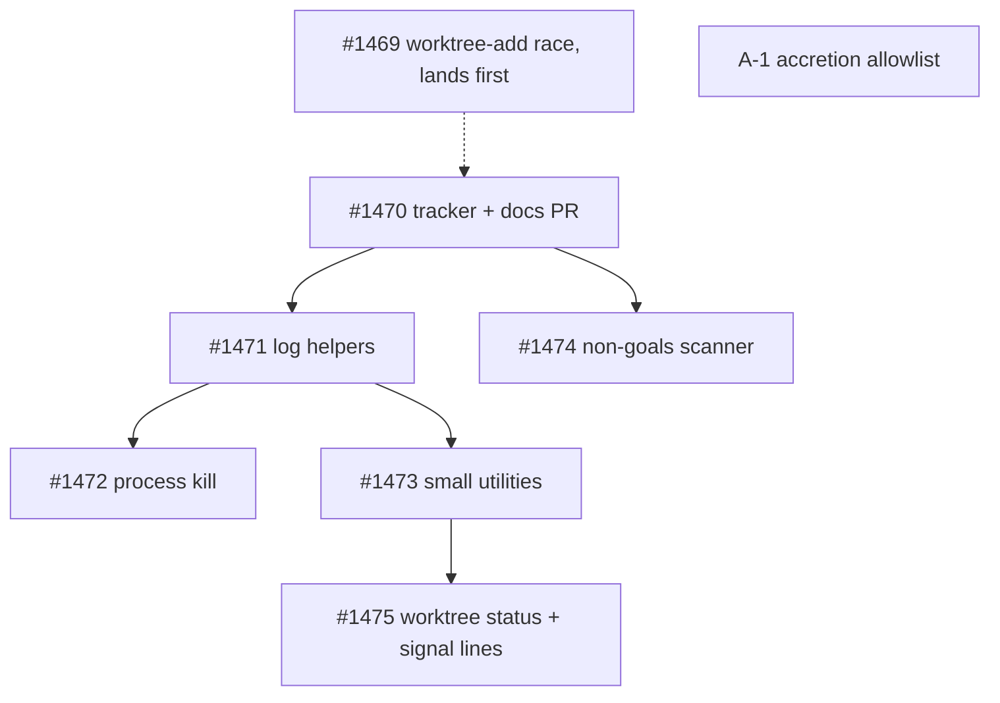

# Issue graph: graph-2026-10-consolidation

**Status:** Planned 2026-10-16, amended after four verified research passes (non-goals direction reversed, worktree node split out, kill helper API fixed, race bug #1469 added outside the graph); owner approved the plan and OQ-1 the same day; **filed 2026-10-16** as #1469 (#1469), #1470 (tracker) and #1471–#1475. The issue bodies on GitHub are canonical; `issues/<N>.md` is the as-filed snapshot (R-1 is `issues/1469.md`). Not launched: waits for PR #1370 and release 2.20.0 (I-5).
**Founding doc:** `PROJECT-DISCUSSION.md` (cited as §N). **Tracker:** #1470. **Source audit:** `~/Projects/accretion-audit` README P0.1 and `dogfood/baseline-sequant.md`.

## Nodes

| Node | Tier | Execution | Title | Blocked by | May touch | Cluster |
|---|---|---|---|---|---|---|
| #1470 | judgment | runner | tracker; docs-only PR landing this directory | — | `docs/internal/graph-2026-10-consolidation/` | — |
| #1471 | mechanical | sequant_run | log helpers → `src/lib/run-logs.ts`; `formatDuration` → `cli-ui/format.ts` | #1470 | `commands/logs.ts`, `commands/stats.ts`, `mcp/tools/logs.ts`, `mcp/tools/run.ts`, `merge-check/index.ts`, `phase-executor.ts`, `cli-ui/format.ts` | mcp-run, format |
| #1472 | judgment | sequant_run | one `killProcessGroup(child, { graceMs })` with SIGKILL escalation, `pushLines` on `RingBuffer`; closes the AsyncSubprocess trigger | #1471 | `drivers/codex.ts`, `drivers/opencode.ts`, `mcp/tools/run.ts`, `ring-buffer.ts`, `process-group.ts` (new) | mcp-run |
| #1473 | mechanical | sequant_run | `ensureDir`, `escapeRegex`, `formatTimestamp`, `truncateToWidth`, `parseIssueNumber` | #1471 | `lib/fs.ts`, `lib/regex.ts` (new), `lib/cli-flags.ts`, `cli-ui/format.ts`, `cli-ui/truncate.ts` (new), `ui/tui/truncate.ts`, `relay/writer.ts`, `upstream/assessment.ts`, three detector files, `commands/watch.ts`, `commands/locks.ts`, `commands/worktree.ts`, `assess/renderer.ts` | format, locks |
| #1474 | judgment | sequant_run | one non-goals scanner with the gate's rules (D-7); `ready-gate.ts` re-exports, `scope/analyzer.ts` wraps | #1470 | `markdown-fence.ts` or `non-goals.ts` (new), `ready-gate.ts`, `scope/analyzer.ts`, fixtures | — |
| #1475 | judgment | sequant_run | `worktreeStatus` tri-state primitive (call-site defaults unchanged, truthful shutdown log); `formatSignalLine` | #1473 | `worktree-manager.ts`, `run-orchestrator.ts`, `chain-resume.integration.test.ts`, `lib/locks/`, `commands/locks.ts` | locks |
| A-1 | mechanical | runner (cross-repo) | allowlist `git`, `filterLogs`, `buildLoopContext`, `isTerminalStatus` in accretion-audit `dogfood/sequant.allowlist.json` | — | accretion-audit only | — |
| #1469 | judgment | sequant_run, **outside this graph, lands first** | a failed `git worktree add` must fail the issue, not run its phases in the main checkout; retry the `.git/config` lock | — | `worktree-manager.ts`, `run-orchestrator.ts`, `phase-executor.ts` (`recordWorktreeBaseRef`) | — |

Critical path: #1470 → #1471 → #1473 → #1475 (four PRs in sequence); #1472 runs beside #1473; #1474 runs beside #1471. A-1 is independent and lands in the other repo. #1469 is not a graph node: it is the bug the runner hit on 2026-10-15 and it should merge before the graph launches, or the runner serializes worktree creation by launching parallel nodes in one `sequant run` (D-8).

## File-overlap clusters (serialize within a cluster)

- **mcp-run:** `src/mcp/tools/run.ts` — #1471 (resolveLogDir) then #1472 (killProcessGroup).
- **format:** `src/lib/cli-ui/format.ts` — #1471 (formatDuration) then #1473 (formatTimestamp).
- **locks:** `src/commands/locks.ts` — #1473 (parseIssueNumber) then #1475 (formatSignalLine).

## Tiers

`judgment` for #1472 (signal semantics, D-1, four prior fixes), #1474 (the #947 class; the first draft had the direction backwards) and #1475 (two documented failure defaults, D-1b); `mechanical` for #1471 and #1473 (byte-identical or same-contract moves with pinned tests).

## Owner gates before launch

- OQ-1 (D-1, SIGKILL escalation for the drivers) answered on the tracker before #1472's exec.
- OQ-2 dissolved 2026-10-16: both `isWorktreeDirty` callers document opposite defaults on purpose, so D-1b shares the git primitive and keeps each default; no owner decision.
- #1469 merged, or parallel nodes launched in one `sequant run` (D-8).
- I-5: PR #1370 and release 2.20.0 have landed.

## Anti-gap passes (2026-10-16)

1. **Journey walk:** owner reads the baseline → five PRs → re-runs `accretion dups` → zero real groups. Every step has a node (#1471..#1475, A-1 for the noise).
2. **Artifact walk:** each shared module has one owner node; `cli-ui/format.ts` is touched twice, in order (format cluster).
3. **Producer/consumer:** the detector's allowlist (A-1) is produced in accretion-audit and consumed by #1470 AC-3; the trigger config `dogfood/sequant.triggers.json` is consumed by #1472 AC-4 and produced by accretion-audit #7 (already on its main).
4. **Shared-file ownership:** the three clusters above; `architecture-target.md` gets one line from #1472 only; the changelog follows `main`'s convention at merge time (fragments after PR #1370).
5. **First-episode dry run:** #1471's exec creates `run-logs.ts`, moves four helpers, deletes five copies, adds a test, runs the detector command; QA re-runs the four Evidence commands. The only work no node covers is acking fire `fcc45c51e344aabb` after #1472 merges, which is the owner's (#13 in accretion-audit) until accretion #29 automates it.

Reachability: every node is on the path to §2's MVP sentence. Deliberate exception: A-1 removes noise from the report rather than code from sequant.

## Placeholder map (filled at filing)

| Placeholder | Issue |
|---|---|
| #C-0 | #1470 |
| #C-1 | #1471 |
| #C-2 | #1472 |
| #C-3 | #1473 |
| #C-4 | #1474 |
| #C-5 | #1475 |
| #R-1 | #1469 |
