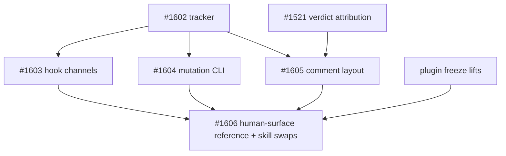

# Issue graph: graph-2026-10-ergonomics

**Status:** Planned 2026-10-26 from a session audit (`phase0-evidence.md`). Founding doc: `PROJECT-DISCUSSION.md` (cited as §N). Tracker: #1602. Issue bodies on GitHub are canonical; `issues/<N>.md` is the as-filed snapshot.

Four contracts, one owner each (§1). Every node but the last is CLI/TS only and lands under the plugin freeze (C-1); the last swaps skill prose for the calls the earlier nodes created.

## Nodes

| Node | Tier | Execution | Title | Blocked by | May touch | Contract |
|---|---|---|---|---|---|---|
| #1602 | judgment | runner | tracker; docs-only PR; label; OQ-1..3 recorded | none | `docs/internal/graph-2026-10-ergonomics/` | — |
| #1603 | mechanical | sequant_run | `doctor` Hook-channels check; `init`/`update` skip the hooks group when a sequant plugin is enabled; manifest records `hooks: plugin` | #1602 | `commands/doctor.ts`, `commands/init.ts`, `commands/update.ts`, manifest schema, `docs/features/plugin-distribution.md` | §3 |
| #1604 | judgment | sequant_run | `sequant mutation begin / check / render`: clean-tree precondition, real run, patch restore, one marker producer from `.sequant/mutations/<N>.json` | #1602 | `commands/mutation.ts` (new), `lib/workflow/mutation-marker.ts`, `bin/cli.ts`, PR-body assembly after exec, `docs/reference/mutation-verification.md` | §4 |
| #1605 | mechanical | sequant_run | `renderIssueComment` layout owner; parser-anchored lines stay outside `
`; adopted by `buildQaVerdictComment`, merge-check report, review-residue; hidden `sequant comment render` | #1602, #1521 | `lib/workflow/comment-layout.ts` (new), `batch-executor.ts`, `merge-check/report.ts`, `review-residue.post.ts`, `bin/cli.ts` | §5 D-3.1 |
| #1606 | judgment | split | `_shared/references/human-surface.md`; skills cite it; `AskUserQuestion` in allowed-tools; spec/qa/exec call `sequant comment render` and `sequant mutation …`; `lint:skill-gates` phrases | #1603, #1604, #1605, **freeze lift** | `.claude/skills/**`, `templates/skills/**`, `plugin/skills/**` (via sync), `scripts/lint-skill-gates.ts` | §5 D-3.2..3.5, §4 D-2.4 |

## Waves

| Wave | Nodes | Condition |
|---|---|---|
| W0 | #1602; then #1603 and #1604 in one `sequant run` (disjoint files) | docs PR merged |
| W0b | #1605 | #1521 merged (shared edit of `buildQaVerdictComment`) |
| W1 | #1606 | W0 and W0b merged and the owner lifts the plugin freeze |

## Outside the graph (repo-local, filed without the label)

- #1599 split or shard the `test` CI job (E-4: it is the whole 8.5-minute wall).
- #1600 prune the 149 merged remote branches; flip `delete_branch_on_merge` after one verifying PR (§6 D-4.1).
- #1601 group Dependabot into one weekly batch per ecosystem (E-4: 20 of 39 closed unmerged).
- #1596 entire 0.12 hook set in `.claude/settings.json` (filed first, in flight).

## Owner-local (not issues)

Owner-local environment fixes (entire upgrade, personal mod layout, shell and settings hygiene, memory cleanup) were done the same day and are not issues.
