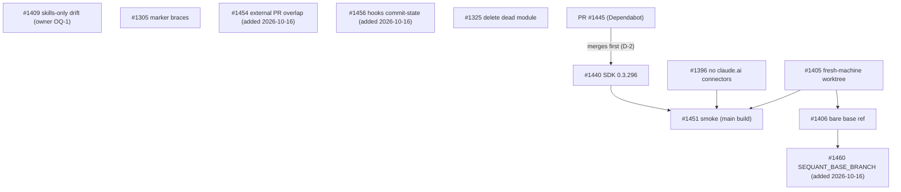

# Issue graph: graph-2026-10-freeze-b

**Status:** Approved and filed 2026-10-16. #1454, #1456 and #1460 added the same day at the owner's request (relayed by session sequant-b9, confirmed by the owner here). #1456's caller test avoids `sync`'s tests, which are #1409's scope; #1399 (outside the graph) later edits the same module, and whichever lands second rebases. From filing on, the issue bodies on GitHub are canonical and `issues/*.md` is the as-filed snapshot.
**Founding doc:** `PROJECT-DISCUSSION.md` (cited as §N). **Tracker:** #1452. **Smoke node (R-1 in review):** #1451.

## Nodes

| Node | Tier | Execution | Title | Blocked by | May touch | Cluster |
|---|---|---|---|---|---|---|
| #1440 | mechanical | sequant_run | SDK floor `^0.3.296` + README line, after #1445 merges | — (#1445 merges first, D-2) | `package.json`, `package-lock.json`, `README.md` | — |
| #1396 | mechanical | split | phase agents get claude.ai connectors: set `disableClaudeAiConnectors` | — (D-4: no edge to #1440) | `drivers/claude-code.ts`, MCP allowlist doc | — |
| #1405 | judgment | sequant_run | fresh-machine first creation ignores `origin/<branch>`; repeat recreate | — | `worktree-manager.ts` (`ensureWorktree`) | worktree-manager |
| #1406 | mechanical | sequant_run | bare non-default base: creation vs staleness disagree | #1405 (D-5) | `worktree-manager.ts` (`computeWorktreeBaseRef`, `countCommitsBehind`) | worktree-manager |
| #1409 | judgment | sequant_run | skills-only install drifts forever; remedy overwrites the constitution | — (owner OQ-1 before exec) | `sync.ts`, `version-preflight.ts`, `init.ts`, `manifest.ts` | — |
| #1305 | mechanical | sequant_run | mutation marker with `}` parses to nothing | — | `mutation-marker.ts` | — |
| #1325 | mechanical | sequant_run | delete unused `plugin-version-sync.ts` | #1301 (closed) | `src/lib/plugin-version-sync*.ts`, `docs/internal/plugin-updates.md` | — |
| #1454 | judgment | sequant_run | open PRs on origin join `merge --check` overlap warnings (+ `/assess` library function, D-8) | — | `src/lib/merge-check/`, `assess-collision-detect.ts`, `platforms/github.ts`, `platform-provider.ts` | — |
| #1456 | mechanical | sequant_run | uncommitted `.claude/hooks/` changes go unwarned; extend the #1354 commit-state check | — | `src/lib/skills-commit-state.ts`, its tests, one `doctor` or `run-orchestrator` caller test | — |
| #1460 | judgment | sequant_run | phase agents never get `SEQUANT_BASE_BRANCH`; `resolveBaseRef` falls back to a literal `origin/main` | #1406 (D-9) | `phase-executor.ts` (env block, `resolveBaseRef`), `worktree-manager.ts` (`detectDefaultBranch` signature only), `docs/reference/run-command.md` | worktree-manager |
| #1451 | judgment | runner | smoke a `main` build: no connectors, CC ≥ 2.1.296, fresh-clone worktree | #1440, #1396, #1405 | none in the repo; the private fixture repo | — |

## File-overlap clusters (serialize within a cluster)

- **worktree-manager:** #1405 (`ensureWorktree`), then #1406 (`computeWorktreeBaseRef`, `countCommitsBehind`), then #1460 (`detectDefaultBranch` gains an optional `cwd`). Disjoint functions, shared temp-repo test harness (D-5, D-9).
- **CHANGELOG `[Unreleased]`:** every code node. Expect trivial conflicts until #1370 lands after the freeze; resolve with a local `git merge origin/main`.
- **Docs:** #1440 (Claude Code version page) and #1396 (MCP allowlist page). Different pages; if they turn out to be the same page, merge #1440 first.

## DAG

## Waves (file-disjoint within each wave; merges one at a time, `main` strict up to date)

- **Wave 1:** the runner merges Dependabot #1445 first (owner consent). Then #1440, #1396, #1405, #1305, #1325 as five `sequant_run` calls, one issue each. #1409 is in wave 1 (OQ-1 ruled at review: record the scope).
- **Wave 2:** #1406 (after #1405 merges), #1451 (after #1440, #1396, #1405 merge), #1454 and #1456 (no edges; wave 2, both added after filing at the owner's request).
- **Wave 3:** #1460, after #1406 merges (D-9).
- **Critical path:** #1405 → #1451. #1405 is the only judgment-tier node on the MVP path. Each merge costs about 9 minutes of CI plus an update-branch cycle whenever `main` moves; five wave-1 merges in sequence are about an hour of CI.

## Anti-gap passes (run 2026-10-16)

1. **Journey walk** (a user runs `sequant run` on an issue whose PR came from another machine, on an account with connectors): install → phase agent starts (#1440: CLI version; #1396: connectors) → worktree on a fresh clone (#1405) → worktree against a non-default base (#1406) → QA reads mutation markers (#1305) → `status` shows drift (#1409). Every step maps to one node. **Gap found and closed:** no node checked #1396 and #1440 on a real phase agent, because MCP phases run the npm pin (I-6). #1451 was added.
2. **Artifact walk:** SDK version in the lockfile (#1440); `query()` options (#1396); worktree starting commit (#1405); base ref (#1406); manifest scope field (#1409); mutation marker (#1305); `plugin-updates.md` (#1325); smoke report (#1451). Each has one owner and a failure mode in §6.
3. **Producer/consumer:** #1451 consumes `npm pack` of `main` after #1440, #1396, #1405 (edges declared). #1409 consumes the owner's OQ-1 ruling (human dependency, flagged). #1406's AC-1 test consumes #1405's harness changes (edge declared). #1440 consumes `main` after #1445 merges (D-2; the runner merges #1445 before launching #1440). #1451 consumes an account with claude.ai connectors (human-provided; the owner's account has five, measured 2026-10-16).
4. **Shared-file ownership:** `worktree-manager.ts` has two writers, serialized (D-5). `.sequant-manifest.json`: 11 reader/writer modules; `src/lib/manifest.ts` owns the format and #1409 adds any field there (§9 OQ-1). `package-lock.json`: #1440 and Dependabot (#1445, #1450). #1445 merges first; #1450 (dev deps, also `package.json`) may then conflict, so resolve it with Dependabot's `@dependabot rebase`, or `npm install` after a `git merge origin/main`, never by hand-editing. **Committed copy deployed elsewhere:** none. No node edits a routine prompt, hosted config or env var.
5. **First-episode dry run:** wave 1 launches five runs; #1396's exec writes the option and the test, and its PR body notes AC-1 is #1451's; #1440 launches only after the runner has merged #1445. The runner checks each PR, records mutation markers, the owner consents, the runner runs I-1 and merges one at a time. Wave 2: #1406, then #1451 under `launchctl`. **Gap found:** #1440 regenerating the lockfile from `main` would leave #1445's other bumps behind. Fixed by merging #1445 first (D-2). **Gap found:** #1409 can't start until the owner rules. Recorded as OQ-1 and asked at this review.

**Reachability:** #1440, #1396, #1405 and #1451 are on the §2 MVP path. #1406 is the same bug class as #1405 on the neighbouring path. #1409, #1305, #1325, #1454, #1456 and #1460 are deliberate exceptions: freeze-safe fixes that don't block the MVP.

## Edits to apply at filing (after review)

0. `gh label create graph-2026-10-freeze-b`.
1. Replace the bodies of #1440, #1396, #1405, #1406, #1409, #1305 and #1325 with `issues/<N>.md`, and add the label. #1409's AC-4 text is rewritten first if the owner rules OQ-1 differently from the recommendation.
2. File the smoke node with the label: filed as #1451 (`issues/1451.md`).
3. File a tracker issue with this node table, the clusters section and the DAG, with no closing keywords.
4. Commit `PROJECT-DISCUSSION.md`, `issue-graph.md`, `issues/` and `evidence/` to `docs/internal/graph-2026-10-freeze-b/` in a docs-only PR (I-1 safe).
