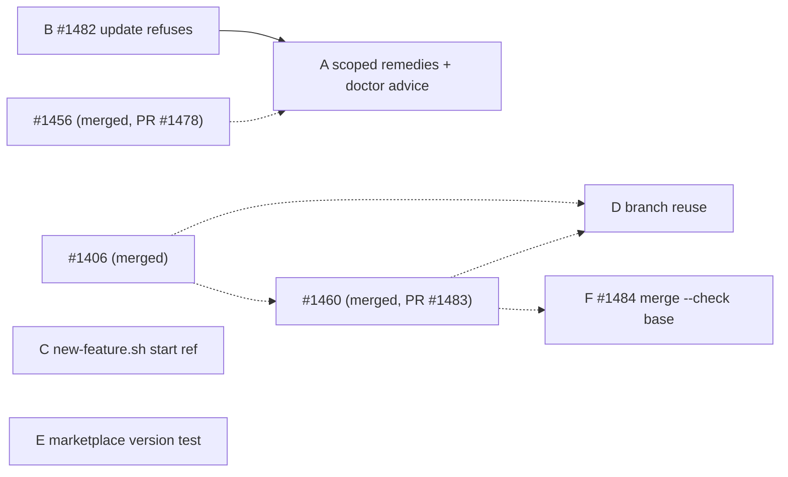

# graph-2026-10-freeze-c: issue graph

**Status:** Filed 2026-10-17. Each GitHub issue body is canonical. `issues/*.md` are copies of the bodies taken when this doc was committed.

## Nodes

| Node | Issue | Title (short) | Tier | Execution | Blocked by | May touch |
|---|---|---|---|---|---|---|
| B | #1482 | `update` refuses on a partial scope | mechanical | sequant_run | — | `update.ts`, `manifest.ts`, `update*.test.ts`, `sync.install-scope.integration.test.ts`, ADR-0015, `installation.md`, CHANGELOG |
| A | #1485 | scoped fix messages in `doctor` and plain `sync`; `doctor` advice for old-style manifests | mechanical | sequant_run | #1482, #1456 (merged) | `sync.ts`, `doctor.ts`, `mcp/server.ts` (text), `doctor.test.ts`, `sync.install-scope.integration.test.ts`, `sync.test.ts`, CHANGELOG |
| C | #1486 | `new-feature.sh` starts from `origin/<branch>`; parity test with `resolveBranchStartRef` | mechanical | sequant_run | — | `templates/scripts/new-feature.sh`, `__tests__/new-feature-start-ref.integration.test.ts` (new), `docs/guides/git-workflows.md`, CHANGELOG |
| D | #1487 | reuse the issue's existing branch whatever the title | judgment | sequant_run | #1406 (merged), #1460 (merged) | `worktree-manager.ts`, `batch-executor.ts` (`getIssueInfo`), `run-orchestrator.ts` (warning), `worktree-manager.test.ts`, `get-issue-info.test.ts`, CHANGELOG |
| E | #1488 | unit test: marketplace version matches `package.json` | mechanical | sequant_run | — | `scripts/plugin-mcp-pin.test.ts`, `docs/internal/plugin-updates.md` |
| F | #1484 | `merge --check` resolves its base ref once instead of hardcoding `origin/main` | mechanical | sequant_run | #1460 (merged) | `src/lib/merge-check/**`, `merge-check-base.integration.test.ts` (new), `docs/reference/merge-command.md`, CHANGELOG |

Filed 2026-10-17 in this order (placeholder → issue): A → #1485, C → #1486, D → #1487, E → #1488. #1482 (B) was amended in place. Tracker: #1492. OQ-3 side issues, outside the graph: #1489 (`doctor` AGENTS.md advice, after #1485), #1490 (`doctor` content drift, after #1485), #1491 (`new-feature.sh` local branch, after #1486). R-1: #1060 comment 6230755477.

## DAG

Dotted edges are freeze-b nodes.

## Waves

- **W1:** B, C, D and E can run in parallel. Their file scopes are disjoint apart from CHANGELOG.
- **W2:** A, once B has merged (#1456 merged at 9835fd17d). Before launching A, re-run AC-6's grep on post-B `main`: if B's ADR edit already says `sequant init` in the Decision section, tighten the grep first. D moved to W1 (#1460 merged at de03af8cd; OQ-2 ruled).
- **W3:** F (#1484). It joined after approval (D-9) and runs alone.

Critical path: B → A. D (judgment) is the largest single node.

## Execution record

All merges were squashes, each with the owner's consent and I-1 checked first.

| Node | PR | Merged as | Runner fixes before merge |
|---|---|---|---|
| C #1486 | #1495 | 853403316 | — |
| E #1488 | #1496 | 8623135ac | — |
| B #1482 | #1494 | 96990daab | a stale `.mcp.json` pin in the test; `getInstallScope` added to the `manifest.js` mock in `unmanaged-skill-safety.integration.test.ts` |
| D #1487 | #1497 | e6935b745 | the ambiguous-branch failure reason recorded; mutation records |
| A #1485 | #1498 | e80353212 | AC-4's test now checks doctor's message through the real `scopedRemedy`; the sync summary no longer names `--only skills` when the user did not pass it |
| F #1484 | #1500 | 74703cb46 | the `filesModified` diff uses the worktree's HEAD when a worktree holds the branch; cleanup restores the base branch, not a hardcoded `main` |

#1493 (#1469, outside the graph) merged as 73d007860 before #1495. D's AC-2 clause "the issue fails" relies on it.

## Merge-order members outside the graph

- `worktree-manager.ts`: #1469 (`ensureWorktree` failure path, no graph) and #1475 (consolidation C-5, after 2.20.0).
- `batch-executor.ts`: #1474 (consolidation C-4).
- CHANGELOG: every open code PR.

## Anti-gap passes (2026-10-16)

1. **Journey walk.** For a skills-only adopter:
   - Upgrade: B, plus `sync --only skills`, which already works (measured).
   - Ask why something drifts: A AC-1 and AC-2.
   - Old manifest: A AC-3, plus D-2's hand edit.
   - A run's QA re-run: D.
   - Standalone `/exec` through the shell helper: C.
   - Release: E.

   Every step maps to one node. Gap found and kept out of scope: the plain `sync` at a version mismatch (OQ-1).
2. **Artifact walk.** Each artifact has one owner:
   - `.sequant-manifest.json` `groups`: `manifest.ts`; B and A only read it.
   - The branch name: `ensureWorktree` (D) and `new-feature.sh` (C), with no shared code by design, and a parity test only for the start ref.
   - The marketplace version: `release.sh` and `prepare-marketplace.ts`, checked by E.
3. **Producer/consumer.**
   - Fix-message text: every producer is listed in A's body, and A AC-4 asserts all of them.
   - Branch name: three producers (`ensureWorktree`, `new-feature.sh`, the frozen `/exec` prose). The prose is a Non-Goal under the freeze.
4. **Shared files.**
   - `sync.install-scope.integration.test.ts`: B and A, serialized (D-6).
   - `doctor.test.ts`: A after #1478 (merged).
   - `worktree-manager.ts`: D after #1460 (merged).
   - CHANGELOG: everyone.
   - No committed copy of a deployed artifact: `scripts/dev/new-feature.sh` in user repos updates on release (C Non-Goal).
5. **Dry run.** W1 lands three small PRs. W2 waits on two owner rulings and two freeze-b merges. The runner files R-1 (#1060 line) at filing time. Nothing in the narrative is uncovered.

Reachability: every node is on the MVP sentence (§2).
