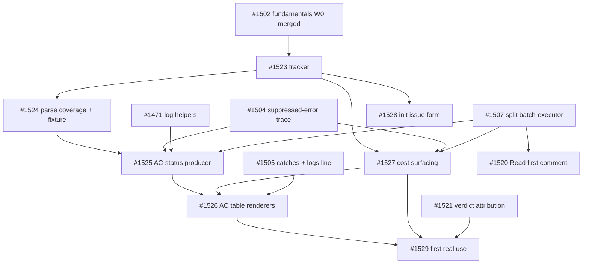

# Issue graph: graph-2026-10-review-surface

**Status:** Planned 2026-10-18; owner approved every default the same day ("yes to all"); **filed 2026-10-18** as #1523 (tracker) and #1524–#1529 in numeric order; #1520 and #1521 retrofitted with the label, the Epic line and (#1520) `- **Blocked by**: #1507`. The issue bodies on GitHub are canonical; `issues/<N>.md` is the as-filed snapshot. Unfolded (RS-04 kept independent so the cost line lands in W1). Launch waits for #1502 (fundamentals wave 0) per #1501 D-1; #1525 additionally waits for #1504, #1471 and #1507 by file scope.
**Founding doc:** `PROJECT-DISCUSSION.md` (cited as §N). **Tracker:** #1523. **Phase-0 record:** `phase0-evidence.md` (36 ACs: 29 fail today, 6 constraint, 1 not-runnable, 0 pass by accident).

## Nodes

| Node | Tier | Execution | Title | Blocked by | May touch | Cluster |
|---|---|---|---|---|---|---|
| #1523 | judgment | runner | tracker; docs-only PR; label; RD-1, OQ-2..5 recorded | #1502 | `docs/internal/graph-2026-10-review-surface/` | — |
| #1524 | judgment | split | per-AC parse coverage on all QA-marked comments since 2026-08-01 (49 at planning); 10 hand-labelled fixtures; RD-1 line; owner adds the blind re-read | #1523 | `scripts/qa/ac-status-parse-coverage.ts`, `__tests__/fixtures/qa-comments/`, `docs/evidence/review-surface/` | — |
| #1525 | judgment | sequant_run | AC-status producer: parse at the QA summary hook, `updateACStatus`, run-log `acs[]`, `unknown` is a status | #1524, #1504, #1471, #1507 | `ac-status.ts` (new), one call line at the hook, `log-writer.ts`, `run-log-schema.ts` | log |
| #1526 | mechanical | sequant_run | AC lines in the run summary; `ACs` column in `status`; block in `logs` | #1525, #1527, #1505 | `run-renderer-types.ts`, renderers, `commands/status.ts`, `commands/logs.ts`, two docs pages | log, renderer |
| #1527 | mechanical | sequant_run | cost line in the summary; run-log `cost` (run-level); `logs` line; "SDK estimate" wording | #1523, #1504, #1507 | `log-writer.ts`, `run-log-schema.ts`, `run-renderer-types.ts`, renderers, `commands/run-display.ts`, `toIssueSummary` (batch-executor, after #1507), `commands/logs.ts`, `run-command.md` | log, renderer |
| #1528 | mechanical | sequant_run | `init` writes the issue form from one template file; guide links it; `doctor` info line | #1523 | `templates/github/ISSUE_TEMPLATE/sequant-task.yml` (new), `commands/init.ts`, `commands/doctor.ts`, `docs/guides/writing-issues.md` | — |
| #1521 | mechanical | split | verdict comment names reviewer driver + model; docs name `phases.qa.agent` | none (coordinate with #1507) | `qa-verdict-attribution.ts` (new), one call in `buildQaVerdictComment`, `run-command.md` | — |
| #1520 | judgment | split | computed "Read first" PR comment: residue / tests by seam / AC-explained | #1507 (file scope) | `review-residue.ts` (new), one post call, `scripts/qa/ac-attribution-rate.ts`, `residue-outcomes.ts`, `docs/reference/review-residue.md` | — |
| #1529 | judgment | runner | first real use: one testbed run; owner reads table vs comment vs cost; reject routes | #1526, #1527, #1521 | smoke report comment only | — |

## Waves

| Wave | Nodes | Condition |
|---|---|---|
| W0 | #1523; then #1524, #1528, #1521 in one `sequant run` | #1502 merged (D-1) |
| W1 | #1527 | #1504 and #1507 merged (the summary input is assembled in batch-executor's `toIssueSummary`) |
| W2 | #1525 | #1524's RD-1 line on the tracker; #1504, #1471, #1507 merged |
| W3 | #1526, #1520 | #1525 and #1505 merged; #1507 merged |
| W4 | #1529 | #1526, #1527, #1521 merged; OQ-5 names the testbed |

**Critical path:** #1502 → #1523 → #1524 → #1525 (also behind #1504, #1471, #1507) → #1526 (also behind #1505) → #1529. Six merges in this graph, four of them also gated on consolidation and fundamentals nodes. **What lands early:** only #1524, #1528 and #1521 (W0). The cost line, the AC table and the Read-first comment all sit behind #1507, which sits behind consolidation's launch gate (#1370, 2.20.0).

**Clusters (serialize, §8):** log: #1527 → #1525 → #1526 (`log-writer.ts`, `run-log-schema.ts`, `commands/logs.ts`; optional fields only, one block per node, after #1504's and #1505's). renderer: #1527 → #1526 (`run-renderer-types.ts`, renderer implementations; one optional field per node).

## Counts

- New files here: 7 (#1523..#1529). Already filed and joining: 2 (#1520, #1521). Nodes: 9. New issues to file: 7.
- Folds available at review: #1527 into #1526 (one renderer node, loses W1 parallelism and makes the cost line wait for the producer). Folded: 6 new issues.
- Open backlog at planning: 69 (66 this morning plus #1519, #1520, #1521).

## Anti-gap passes (2026-10-18)

1. **Journey walk** (a reviewer's path): write the issue in the form (#1528) → `sequant run` → terminal shows AC lines and the cost line (#1526, #1527) → `sequant status` shows met-over-total (#1526) → the issue's verdict comment names its reviewer (#1521) → the PR carries "Read first" (#1520) → `sequant logs` shows the same AC lines and cost (#1526, #1527) → human merges. Every step has exactly one owner. Gap found: the status source for the terminal was unowned (nothing updates the record); #1524 and #1525 own it. Second gap: "who decides parser vs marker" was unowned; RD-1 on #1524.
2. **Artifact walk:** the AC record (`state.json`): owner #1525; failure: silent write → counted via #1504 (I-9). Run-log `acs[]` and `cost`: owners #1525 and #1527; optional fields; failure: version bump → AC forbids. `metrics.json` cost: owner `metrics-writer.ts` (unchanged); #1527 reads. The form template: owner #1528; the guide links, never copies (RD-D). Fixtures `qa-comments/`: owner #1524; #1525 reads. Verdict comment: owner `buildQaVerdictComment` (#1521 appends one line). PR comment: #1520 (one per PR). Each artifact has one owner and a named failure mode.
3. **Producer/consumer:** #1526 consumes #1525's record and #1527's field. #1525 consumes #1524's fixture and the QA output at the existing hook. #1527 consumes the metrics writer. #1529 consumes everything plus a testbed (OQ-5, human-named). RD-1 is a human-produced input (flagged). #1520 consumes `Evidence:` clauses, not the AC record, so it does not wait for #1525.
4. **Shared-file format ownership:** `run-log-schema.ts` and `log-writer.ts`: one optional block per node, in the order #1504 → #1527 → #1525; `run-renderer-types.ts`: one optional field per node, #1527 → #1526; `commands/logs.ts`: one block per node after #1471 and #1505. No committed copy of anything deployed elsewhere is touched; the template file is new and single-sourced.
5. **First-episode dry run:** #1523 lands docs, label, decisions. W0 in one `sequant run`: #1524 (reads comments, writes fixtures and a script; QA runs AC-2 against live `gh`, which needs auth in the phase — the same condition #1519 and the stranger smokes already assume), #1528 (init step + doctor line + guide edit), #1521 (one appended line). **Gap:** #1524's AC-5 blind re-read is a human step inside a `sequant_run` node; exec cannot do it. Stamp #1524 `split`: phases write the script, fixture and report; the owner adds the re-read line. **Fixed in the node table below the dry run** (Tier stays judgment; Execution → split). W1: #1527 after #1504 — its `logs.ts` block waits for #1505 if that lands later; the body already says so. W2: #1525 touches the hook; if #1507 has moved the QA summary hook out of batch-executor, the one-line call goes in the new module; the body names both. W3: #1526 and #1520 in one run; distinct files. W4: #1529 by the runner, detached launch (#856). Nothing in the narrative lacks an owner.

**Correction from the dry run:** #1524 Execution is `split`, not `sequant_run` (the blind re-read is the owner's). The issue body is updated to match.

**Reachability:** every node is on the path to the MVP sentence in §2: #1524 → #1525 → #1526 are the AC lines; #1527 the cost line; #1528 the form; #1521 and #1520 the comment surfaces; #1529 the first real use. No deliberate exceptions.

## Phase-0 record

- Measured on this checkout 2026-10-18: AC record 2 of 25 issues, 17 items all `pending`; `updateACStatus` no callers; per-AC parse 23 of 24 on 4 issues (too small; #1524 measures); Evidence names a path for 149 of 258 ACs (58%); metrics 154 of 420 runs with cost, $935.69 total, last run $6.45 / 69,641 tokens / 3 issues; `sequant stats` already has the cost table and wording; the #943 demo run has no cost record (the video's cost number must come from a new run, OQ-5).
- Every Evidence command in `issues/` run on `main` 96990daab: 36 ACs, 29 fail today, 6 constraint, 1 not-runnable (the runner's `$RUNLOG`), 0 pass by accident. Six ACs are gate-classified by `isGateTestEvidence`; each body names them with the mutation they carry.
- Platform: no CI change, no PR from Actions; the label `graph-2026-10-review-surface` does not exist (tracker creates). PR comments go through `PlatformProvider.postPRComment` (merge-check precedent; #1506 consolidates).
- File-scope collisions checked against #1471 (`phase-executor.ts`, `commands/logs.ts`), #1504 (`log-writer.ts`, `run-log-schema.ts`), #1505 (`commands/logs.ts`), #1507 (`batch-executor.ts`): every touching node waits for the owner of that file.

## Placeholder map (as filed 2026-10-18)

| Placeholder | Issue |
|---|---|
| #RS-00 | #1523 |
| #RS-01 | #1524 |
| #RS-02 | #1525 |
| #RS-03 | #1526 |
| #RS-04 | #1527 |
| #RS-05 | #1528 |
| #RS-06 | #1529 |
| (joined) | #1520, #1521 |
