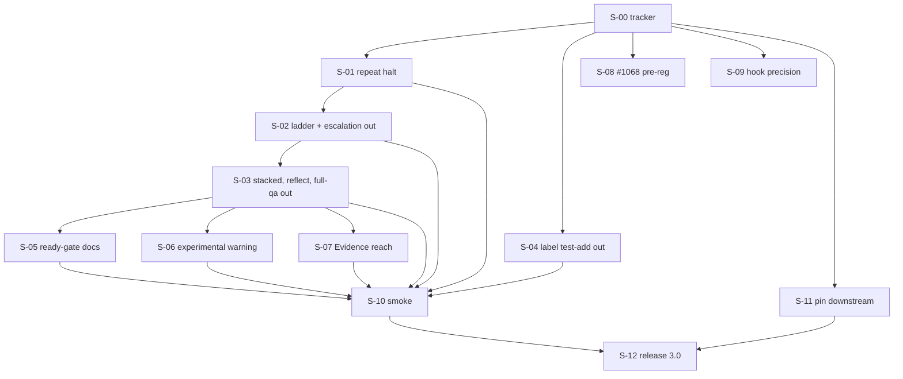

# graph-2026-11-simplify — issue graph

**Status:** approved by the owner and filed 2026-11-07 as #1645 (tracker) and #1646–#1657, label `graph-2026-11-simplify`. **The issue bodies on GitHub are canonical**; `issues/*.md` are the as-filed snapshot and are not synced. Review answers: approve as written (P-1, P-6, P-12 stand), F-10 clusters filed here with D-1 posted on #1501, adjacent issues linked only, stop at every PR.

## DAG

## Waves

| Wave | Nodes | Why together |
|---|---|---|
| W0 | #1645 | docs PR, label, decisions |
| W1 | #1646, #1649, #1653, #1654, #1656 | disjoint files (`batch-executor.ts` quality loop / `phase-mapper.ts` / research repo / logs / harness) |
| W2 | #1647 | the ladder leaves after the halt stands alone |
| W3 | #1648 | shares `bin/cli.ts`, `KNOWN_KEYS`, `types.ts`, `run.ts` with #1647 |
| W4 | #1650, #1651, #1652 | docs pages / `run.ts` / qa dispatch and new module; each edits only its own section of `run-command.md` |
| W5 | #1655 | a `main` build after W1–W4 merge |
| W6 | #1657 | after the smoke and the pin |

**Critical path:** #1645 → #1646 → #1647 → #1648 → #1652 → #1655 → #1657 (seven nodes, three of them judgment tier). #1653 and #1654 are off it and block nothing (founding doc §8, reachability).

## Nodes

| Placeholder | File | Tier | Execution | Blocked by | Closes / links |
|---|---|---|---|---|---|
| #1645 | `00-tracker.md` | mechanical | runner | — | links #1501, #1523, #1602 |
| #1646 | `01-repeat-halt.md` | judgment | split | #1645 | D-2 |
| #1647 | `02-remove-ladder-escalation.md` | judgment | sequant_run | #1646 | D-1; F-10 cluster of #1501 |
| #1648 | `03-remove-stacked-reflect-fullqa.md` | mechanical | sequant_run | #1647 | D-1; F-10 cluster of #1501 |
| #1649 | `04-remove-label-test-add.md` | mechanical | sequant_run | #1645 | D-1; closes #1631 |
| #1650 | `05-ready-gate-docs.md` | mechanical | sequant_run | #1648 | D-2 |
| #1651 | `06-experimental-warning.md` | mechanical | sequant_run | #1648 | D-3 |
| #1652 | `07-evidence-reach.md` | judgment | split | #1648 | D-8; part of #1641 |
| #1653 | `08-1068-preregistration.md` | judgment | runner | #1645 | D-4; #1068, #1272 |
| #1654 | `09-hook-precision.md` | mechanical | owner | #1645 | D-5 |
| #1655 | `10-smoke.md` | judgment | runner | #1646 … #1652 | first real use |
| #1656 | `11-downstream-pin.md` | mechanical | owner | #1645 | release precondition |
| #1657 | `12-release-3.md` | mechanical | owner | #1655, #1656 | 3.0.0 |

## Placeholder map

| Placeholder | Issue |
|---|---|
| `#S-00` | #1645 |
| `#S-01` | #1646 |
| `#S-02` | #1647 |
| `#S-03` | #1648 |
| `#S-04` | #1649 |
| `#S-05` | #1650 |
| `#S-06` | #1651 |
| `#S-07` | #1652 |
| `#S-08` | #1653 |
| `#S-09` | #1654 |
| `#S-10` | #1655 |
| `#S-11` | #1656 |
| `#S-12` | #1657 |

## Anti-gap passes (2026-11-04)

1. **Journey walk** (owner: decide → merge → release → executor keeps running). D-1 → #1647, #1648, #1649 (the `/reflect` skill text parked, §10). D-2 → #1646, #1650. D-3 → #1651. D-4 → #1653. D-5 → #1654. D-6 → this directory and #1645. D-7 → I-1 in every code node. D-8 → #1652 (code half; the skill half parked). Release preconditions → #1656, #1657. Every step maps to exactly one node.
2. **Artifact walk.** Run log (`abortReason`, `evidenceBundle`, error category, `acs[].reach`): written by #1646 and #1652, read by `sequant logs`, kept readable for old fields by #1647 (I-2). Settings: keys removed by #1647, #1648, each with a named-removal warning. Phase list: #1649. qa prompt: #1652. Docs pages: #1647, #1648, #1650, #1651, sections disjoint. Changelog: every code node; the release section by #1657. Hook-precision sheet: #1654 (private), counts page in sequant. Pre-registration: #1653 (private), hash on #1068. Each has one owner and a failure mode in founding doc §6.
3. **Producer/consumer.** #1655 consumes a `main` build (producers #1646 to #1652), two smoke issues (written by the runner at launch) and E2c's `deny.sb` (exists in smpl-sequant). #1657 consumes the smoke answer (owner) and the pin (owner). #1653 consumes fixture #34 and E6/E6b costs (exist in smpl-sequant). #1654 consumes the frozen logs (exist, sha256 in §4). Human dependencies: #1654's labels, #1653's approval, #1655's answer, #1656's route, #1657's two answers.
4. **Shared-file format ownership.** `docs/reference/run-command.md`: four nodes, one section each (§8). `CHANGELOG.md`: `merge=union`, one line per node under `[Unreleased]`; #1657 owns the release header. `src/lib/settings.ts` `KNOWN_KEYS` and the removed-key warning: #1647 creates the warning and `settings.removed-keys.test.ts`, #1648 adds `fullQa` to it. `run-log-schema.ts`: #1646 adds a category, #1652 adds `acs[].reach`, #1647 keeps old fields; additive in each. Committed copies of something deployed elsewhere: `harness/scripts/launch.sh` is run from the owner's terminal, and #1656 is the node that changes it and says who runs it.
5. **First-episode dry run.** W1: the halt PR, the label PR, the pre-registration, the sheet and the pin proceed in parallel. W2: removing the ladder deletes the divergence-suspect block; the halt from W1 is what stops #1162's pattern now (P-2). W3: `--stacked` goes; `run.ts:67-74` loses its implication and `--chain` tests stay green. W4: docs drop the claim; the warning prints; the qa prompt gains the reach block. W5: the smoke runs a build with all of it; if the agent runs the env-file command anyway (OQ-3), the answer is `reopen #1652` with a stronger prompt, or a post-lift skill node, which the owner picks. W6: the pin is in place, 3.0 goes to `next`. No step found without a node.

**Reachability:** every node reaches #1657 except #1653 and #1654 (deliberate: D-4 and D-5 are measurements later cuts wait on).

## Linked, not in the graph

Review candidates (RQ-2): #1640 (print each phase's model), #1642 (record the skill tree's version), #1626 (timeout labelled "Out of credits"), #1630 (CI pending verdict), #1641 (credentials; #1652 covers its ask 3 in code). Other graphs' nodes (D-6): #1501 F-10, #1526, #1521, #1529, #1622 (#1523), #1605, #1606 (#1602). Post-freeze: #1455, #1457, #1459, #1400, #1397.
