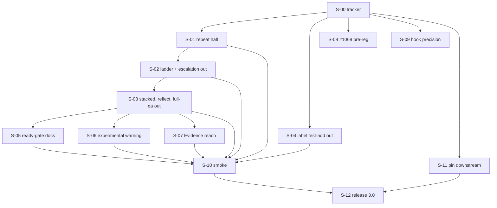

# graph-2026-11-simplify — issue graph

**Status:** plan, 2026-11-04, not filed. `issues/*.md` hold one body each with placeholder edges (`#S-NN`). On filing, the issue bodies on GitHub become canonical and these files the as-filed snapshot; the map below gets its real numbers in the same pass.

## DAG

## Waves

| Wave | Nodes | Why together |
|---|---|---|
| W0 | #S-00 | docs PR, label, decisions |
| W1 | #S-01, #S-04, #S-08, #S-09, #S-11 | disjoint files (`batch-executor.ts` quality loop / `phase-mapper.ts` / research repo / logs / harness) |
| W2 | #S-02 | the ladder leaves after the halt stands alone |
| W3 | #S-03 | shares `bin/cli.ts`, `KNOWN_KEYS`, `types.ts`, `run.ts` with #S-02 |
| W4 | #S-05, #S-06, #S-07 | docs pages / `run.ts` / qa dispatch and new module; each edits only its own section of `run-command.md` |
| W5 | #S-10 | a `main` build after W1–W4 merge |
| W6 | #S-12 | after the smoke and the pin |

**Critical path:** #S-00 → #S-01 → #S-02 → #S-03 → #S-07 → #S-10 → #S-12 (seven nodes, three of them judgment tier). #S-08 and #S-09 are off it and block nothing (founding doc §8, reachability).

## Nodes

| Placeholder | File | Tier | Execution | Blocked by | Closes / links |
|---|---|---|---|---|---|
| #S-00 | `00-tracker.md` | mechanical | runner | — | links #1501, #1523, #1602 |
| #S-01 | `01-repeat-halt.md` | judgment | split | #S-00 | D-2 |
| #S-02 | `02-remove-ladder-escalation.md` | judgment | sequant_run | #S-01 | D-1; F-10 cluster of #1501 |
| #S-03 | `03-remove-stacked-reflect-fullqa.md` | mechanical | sequant_run | #S-02 | D-1; F-10 cluster of #1501 |
| #S-04 | `04-remove-label-test-add.md` | mechanical | sequant_run | #S-00 | D-1; closes #1631 |
| #S-05 | `05-ready-gate-docs.md` | mechanical | sequant_run | #S-03 | D-2 |
| #S-06 | `06-experimental-warning.md` | mechanical | sequant_run | #S-03 | D-3 |
| #S-07 | `07-evidence-reach.md` | judgment | split | #S-03 | D-8; part of #1641 |
| #S-08 | `08-1068-preregistration.md` | judgment | runner | #S-00 | D-4; #1068, #1272 |
| #S-09 | `09-hook-precision.md` | mechanical | owner | #S-00 | D-5 |
| #S-10 | `10-smoke.md` | judgment | runner | #S-01 … #S-07 | first real use |
| #S-11 | `11-downstream-pin.md` | mechanical | owner | #S-00 | release precondition |
| #S-12 | `12-release-3.md` | mechanical | owner | #S-10, #S-11 | 3.0.0 |

## Placeholder map

Filled at filing: `#S-00` → `#…`, through `#S-12`.

## Anti-gap passes (2026-11-04)

1. **Journey walk** (owner: decide → merge → release → executor keeps running). D-1 → #S-02, #S-03, #S-04 (the `/reflect` skill text parked, §10). D-2 → #S-01, #S-05. D-3 → #S-06. D-4 → #S-08. D-5 → #S-09. D-6 → this directory and #S-00. D-7 → I-1 in every code node. D-8 → #S-07 (code half; the skill half parked). Release preconditions → #S-11, #S-12. Every step maps to exactly one node.
2. **Artifact walk.** Run log (`abortReason`, `evidenceBundle`, error category, `acs[].reach`): written by #S-01 and #S-07, read by `sequant logs`, kept readable for old fields by #S-02 (I-2). Settings: keys removed by #S-02, #S-03, each with a named-removal warning. Phase list: #S-04. qa prompt: #S-07. Docs pages: #S-02, #S-03, #S-05, #S-06, sections disjoint. Changelog: every code node; the release section by #S-12. Hook-precision sheet: #S-09 (private), counts page in sequant. Pre-registration: #S-08 (private), hash on #1068. Each has one owner and a failure mode in founding doc §6.
3. **Producer/consumer.** #S-10 consumes a `main` build (producers #S-01 to #S-07), two smoke issues (written by the runner at launch) and E2c's `deny.sb` (exists in smpl-sequant). #S-12 consumes the smoke answer (owner) and the pin (owner). #S-08 consumes fixture #34 and E6/E6b costs (exist in smpl-sequant). #S-09 consumes the frozen logs (exist, sha256 in §4). Human dependencies: #S-09's labels, #S-08's approval, #S-10's answer, #S-11's route, #S-12's two answers.
4. **Shared-file format ownership.** `docs/reference/run-command.md`: four nodes, one section each (§8). `CHANGELOG.md`: `merge=union`, one line per node under `[Unreleased]`; #S-12 owns the release header. `src/lib/settings.ts` `KNOWN_KEYS` and the removed-key warning: #S-02 creates the warning and `settings.removed-keys.test.ts`, #S-03 adds `fullQa` to it. `run-log-schema.ts`: #S-01 adds a category, #S-07 adds `acs[].reach`, #S-02 keeps old fields; additive in each. Committed copies of something deployed elsewhere: `harness/scripts/launch.sh` is run from the owner's terminal, and #S-11 is the node that changes it and says who runs it.
5. **First-episode dry run.** W1: the halt PR, the label PR, the pre-registration, the sheet and the pin proceed in parallel. W2: removing the ladder deletes the divergence-suspect block; the halt from W1 is what stops #1162's pattern now (P-2). W3: `--stacked` goes; `run.ts:67-74` loses its implication and `--chain` tests stay green. W4: docs drop the claim; the warning prints; the qa prompt gains the reach block. W5: the smoke runs a build with all of it; if the agent runs the env-file command anyway (OQ-3), the answer is `reopen #S-07` with a stronger prompt, or a post-lift skill node, which the owner picks. W6: the pin is in place, 3.0 goes to `next`. No step found without a node.

**Reachability:** every node reaches #S-12 except #S-08 and #S-09 (deliberate: D-4 and D-5 are measurements later cuts wait on).

## Linked, not in the graph

Review candidates (RQ-2): #1640 (print each phase's model), #1642 (record the skill tree's version), #1626 (timeout labelled "Out of credits"), #1630 (CI pending verdict), #1641 (credentials; #S-07 covers its ask 3 in code). Other graphs' nodes (D-6): #1501 F-10, #1526, #1521, #1529, #1622 (#1523), #1605, #1606 (#1602). Post-freeze: #1455, #1457, #1459, #1400, #1397.
